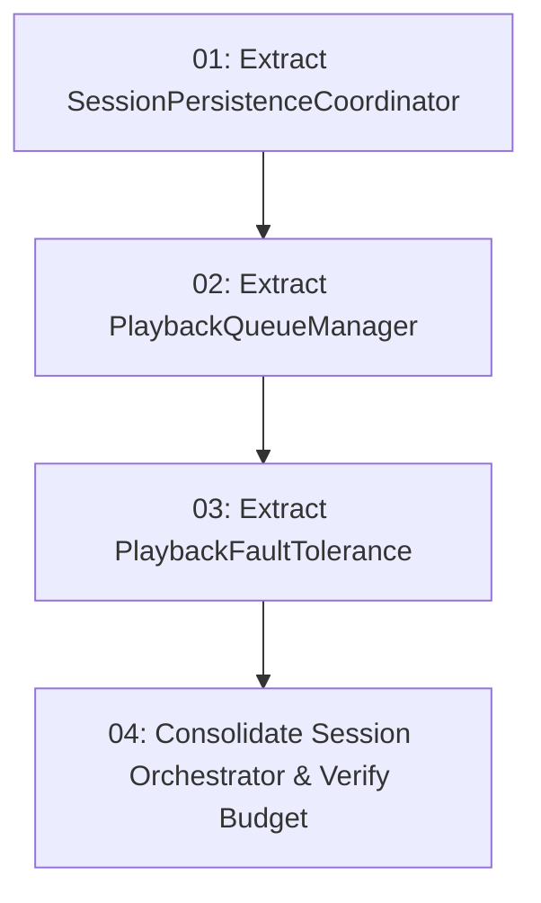

# Decompose Session God Class: Feature Map

## Specification

See [spec.md](./spec.md)

## ADR References

- [ADR-0018: Unify System Playback Intent Routing Through App Session](../../docs/adr/0018-unify-system-playback-intent-routing-through-app-session.md)
- [ADR-0023: Internal Seams and Session Decomposition](../../docs/adr/0023-internal-seams-and-session-decomposition.md)

## Task Graph

## Tickets

- [x] [01: Extract SessionPersistenceCoordinator](./issues/01-extract-session-persistence-coordinator.md)
- [x] [02: Extract PlaybackQueueManager](./issues/02-extract-playback-queue-manager.md)
- [x] [03: Extract PlaybackFaultTolerance](./issues/03-extract-playback-fault-tolerance.md)
- [x] [04: Consolidate Session Orchestrator & Verify Budget](./issues/04-consolidate-session-orchestrator-and-verify-budget.md)

## Decisions so far

- **Ticket 01 (Extract SessionPersistenceCoordinator)**: Extracted `SessionPersistenceCoordinator` to encapsulate `PlaybackSessionStore`, cold restoration, periodic flushing, and per-server directory memory. See [01-extract-session-persistence-coordinator.md](./issues/01-extract-session-persistence-coordinator.md).
- **Ticket 02 (Extract PlaybackQueueManager)**: Extracted `PlaybackQueueManager` to encapsulate queue calculations, loop/shuffle algorithms, ad-hoc insertions, and dead-track cycle prevention. See [02-extract-playback-queue-manager.md](./issues/02-extract-playback-queue-manager.md).
- **Ticket 03 (Extract PlaybackFaultTolerance)**: Extracted `PlaybackFaultTolerance` to encapsulate stream buffering watchdog timers, error classification (404/auth/unreachable), failure skips, unsupported Range replay confirmations, and premature EOF arbitration. See [03-extract-playback-fault-tolerance.md](./issues/03-extract-playback-fault-tolerance.md).
- **Ticket 04 (Consolidate Session Orchestrator & Verify Budget)**: Consolidated `MusicPlayerAppSessionImpl` into a lean orchestrator of 587 lines (< 600 line limit). Preserved 100% external API contracts, verified 935 unit tests passing green, and validated release APK at 6.67 MB (budget <= 7.5 MB). See [04-consolidate-session-orchestrator-and-verify-budget.md](./issues/04-consolidate-session-orchestrator-and-verify-budget.md).
