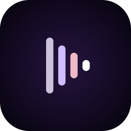
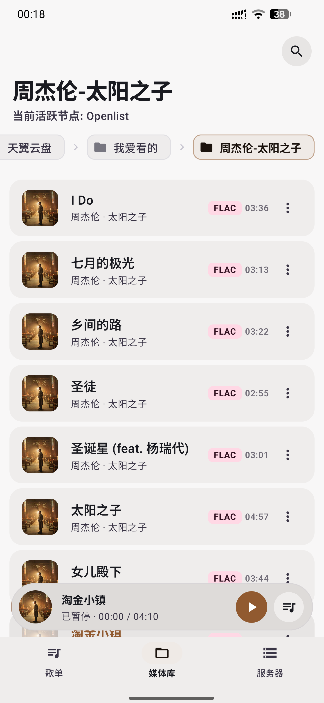
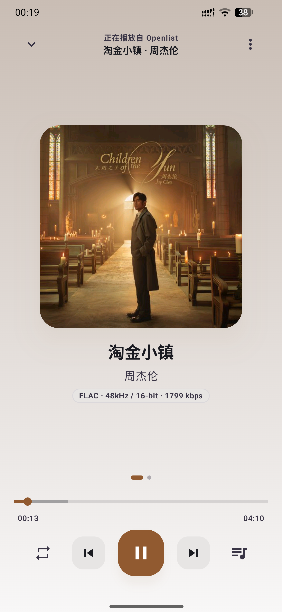
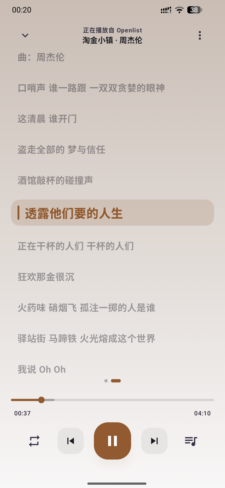
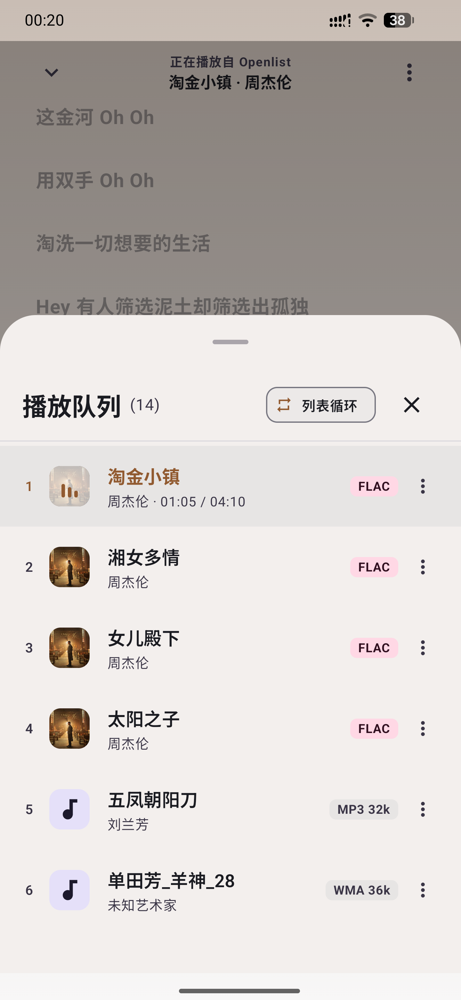
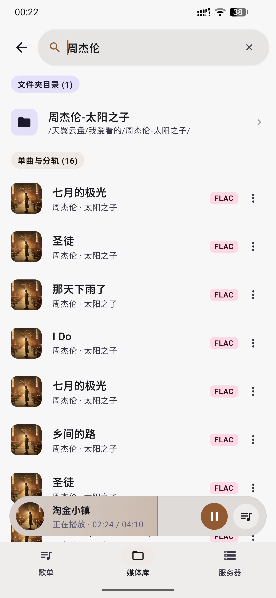
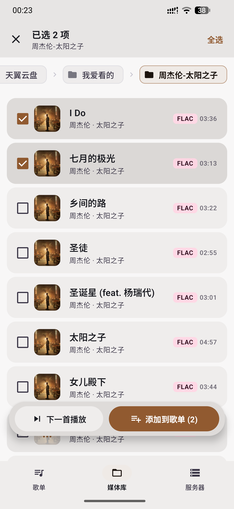
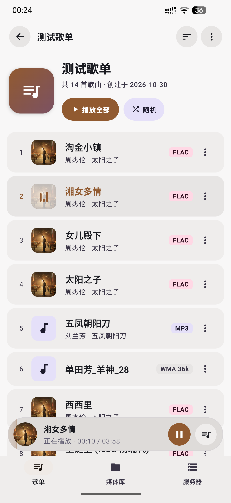
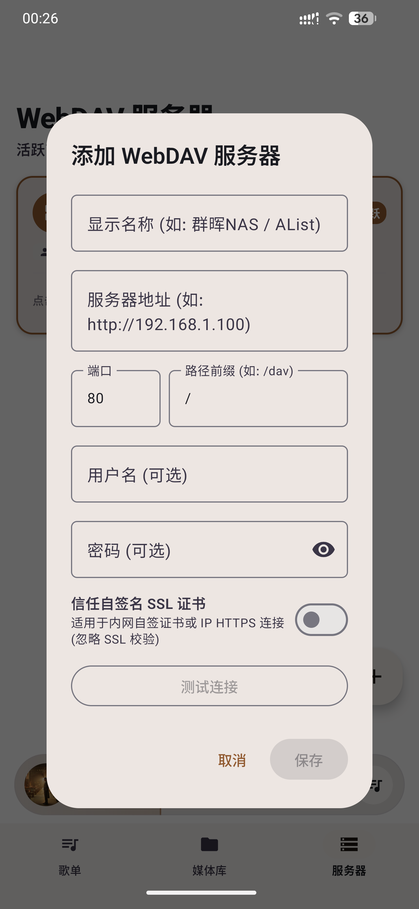

# Aoffee Player 🎵

<p align="center">
  
</p>

<p align="center">
  <strong>专为远程私有云（NAS / 网盘）打造的现代化 Android WebDAV 高保真流式音频播放器</strong>
</p>

<p align="center">
  <a href="https://developer.android.com/about/versions/10"></a>
  <a href="https://kotlinlang.org/"></a>
  <a href="https://isocpp.org/"></a>
  <a href="https://developer.android.com/jetpack/compose"></a>
  <a href="https://developer.android.com/guide/topics/media/media3"></a>
  <a href="LICENSE"></a>
</p>

---

## 📖 项目简介

**Aoffee Player** 是一款遵循 **Google Material 3 Expressive (M3E)** 设计语言的 Android 原生流式音频播放器。

通过标准 WebDAV (HTTP/HTTPS) 协议，用户可直接挂载家庭 NAS（群晖、威联通、TrueNAS）、路由器私有云盘或各类远程服务器中的音乐资产。应用基于 **AndroidX Media3 (ExoPlayer)** 并深度集成 **FFmpeg 原生 C++ JNI 解码扩展**，提供毫秒级在线即点即播体验，无需下载曲目到手机本地，畅享轻量纯粹的云端音乐。

---

## 📱 应用界面展示 (Screenshots)

<div align="center">

### 核心回放与流体视听

| 远程目录浏览与流体底栏 | 全屏沉浸播放器与规格徽标 | 工业级双语平滑聚焦歌词 | 实时流式播放队列 |
| :---: | :---: | :---: | :---: |
|  |  |  |  |
| **SWR 目录秒开 · 流体 MiniPlayer** | **全域动态取色 · Hi-Res/FLAC 胶囊** | **居中锁定 · 双语时间对齐** | **三柱跳动音浪 · 循环模式切换** |

### 交互操作与节点管理

| 曲库毫秒级全文检索 | 上下文批量多选与操作胶囊 | 跨服务器聚合歌单 | WebDAV 节点与自签名证书 |
| :---: | :---: | :---: | :---: |
|  |  |  |  |
| **即打即搜 · 目录与分轨毫秒匹配** | **长按卡片多选 · 悬浮双胶囊** | **80dp Hero Header · 多源收藏** | **标准 HTTP/HTTPS · 自签名 SSL** |

</div>

---

## ✨ 核心功能与特色

### 🚀 纯流式回放，零本地磁盘占用
- **按需分块流式加载**：基于 HTTP Range 按需拉取音频数据，毫秒级起播与平滑拖拽寻道。
- **纯流式无落盘开销**：数据仅在内存及有限缓冲区流动，绝不占用宝贵的手机永久存储空间。
- **完善的音频焦点管理**：自动响应通话打断、系统通知压音（Ducking）与蓝牙断开自动暂停。

### 🎼 全格式支持与硬核音频解码
- **原生双引擎驱动**：主流格式由 AndroidX Media3 高效解码，集成自定义 **FFmpeg Native (C++17)** 软解扩展。
- **全格式无缝播放**：全面兼容 MP3、AAC、OGG、OPUS、WAV、FLAC（高达 24-bit/192kHz Hi-Res）以及原生系统不支持的 **APE** 与 **WMA / ASF**。
- **音质与格式胶囊徽标**：曲目列表与播放器实时呈现专属格式与音频规格徽标（如 Hi-Res、FLAC、WMA、APE 等）。

### ⚡ 智能增量元数据与双源封面
- **按需轻量探测**：仅拉取文件头尾关键字节块，瞬间解析 ID3、VorbisComment、ASF/WMA 等音频标签。
- **双源封面回退机制**：优先读取音频内嵌高清封面；内嵌无图时，智能检索同目录下同名封面或 `cover.jpg`、`folder.jpg`。
- **自愈式元数据缓存**：即便本地图片缓存被外部清理，仓储层也能自动并发自愈修复。

### 📜 工业级歌词与双语平滑滚动
- **双源歌词发现**：自动关联同目录同名 `.lrc` 文件，无外置文件时自动降级读取音频内嵌歌词。
- **智能时间对齐与清洗**：自动清洗词级卡拉OK时间戳并展开副歌，主译双语平行排版、居中锁定与点击快速跳转。

### 🎨 Material 3 Expressive 流体美学
- **全域动态自适应取色**：依据专辑封面主色调实时提取配色方案，整机背景、卡片与控件随切歌平滑渐变换肤。
- **流体微光 Mini 播放器**：独立悬浮胶囊结合正圆黑胶封面，背景随播放进度漫延半透明流体微光。
- **流体交互与手势避让**：连续流体折叠顶栏、自适应 FAB 悬浮按钮避让、独立药丸搜索舱与悬浮多选操作栏。

### 💽 CUE 虚拟分轨与 Gapless 连续播放
- **整轨无损免切分**：对 FLAC/APE/WAV 整轨专辑自动解析关联 CUE 文件，底层单网络流无缝映射，提供 0 爆音无缝播放。
- **目录闭环回流**：列表循环时严格约束在当前活跃目录内自然回流，避免误跨无关目录。

### 🌐 跨服务器歌单与即时曲库搜索
- **多源混合收藏**：支持将来自不同 WebDAV 服务器的音轨收藏到同一个歌单中，自动装配对应服务器鉴权凭据。
- **SWR 目录缓存与离线可用**：基于 Room 数据库缓存远程目录树，二次进入秒开，断网亦可浏览。
- **毫秒级全文检索**：支持多维即时匹配目录、音频标签与虚拟分轨，内置搜索历史管理。

### 🛡️ 私有云连接与后台长效播放
- **自签名 SSL 证书信任**：支持局域网私有 IP HTTPS 及自签名证书一键信任，适配各类家庭私有云与自建服务。
- **首帧前台服务提升**：启动即提升为前台媒体服务，根除 Android 8.0+ 启动超时崩溃。
- **硬件锁与防断流保护**：全方位持有 Wi-Fi/CPU 硬件唤醒锁，锁屏长效播放稳定不中断。

---

## 🌐 支持的 WebDAV 服务器与平台

WebDAVPlayer 严格遵循 **RFC 4918** 标准 WebDAV 规范。以下为经过严格技术核对的主流兼容服务端平台与接入指引：

| 类型 / 场景 | 支持的服务与平台 | 接入路径 / 端口示例 | 关键配置与避坑提示 |
| :--- | :--- | :--- | :--- |
| **家用 NAS 私有系统** | **群晖 Synology** · **威联通 QNAP** · **极空间 Zspace** · **绿联私有云** · **飞牛 fnOS** · **TrueNAS** | 默认端口：<br>HTTP `5005` / HTTPS `5006` | • 群晖在套件中心安装 **WebDAV Server**；<br>• 极空间/绿联/飞牛在「文件服务」中直接勾选开启；<br>• 局域网自签 SSL 连接建议勾选开启「信任自签名证书」。 |
| **聚合网盘网关** | **AList** · **Openlist** · **Rclone** (`serve webdav`) | 基准路径：<br>`/dav` | • 将百度网盘、阿里云盘、天翼云盘、OneDrive 等聚合映射为标准 WebDAV；<br>• 填入 AList 的挂载根路径，支持多源曲库毫秒即点即播。 |
| **开源私有云程序** | **Nextcloud** · **ownCloud** · **Cloudreve** · **FileBrowser Quantum** · **Seafile** | Nextcloud：<br>`/remote.php/dav/files/<user>/`<br>Cloudreve：`/dav` | • Nextcloud/ownCloud 原生自带标准 WebDAV 接口；<br>• Seafile 需开启 `seaf-dav` 模块（默认 8080）；<br>• 原版 FileBrowser 无原生 WebDAV，推荐使用其增强分支 **FileBrowser Quantum**。 |
| **原生 WebDAV 云存储** | **坚果云 (Nutstore)** · **InfiniCLOUD** (原 TeraCLOUD) · **Koofr** · **Yandex Disk** | 坚果云：<br>`https://dav.jianguoyun.com/dav/`<br>Koofr：`/dav/Koofr` | • **注意**：不可使用账户网页登录主密码！需在各网盘网页端「安全设置」中生成专用的 **「应用专属授权密码」** 填入连接。 |
| **自建 Web 协议服务** | **Nginx** · **Apache** (`mod_dav`) · **Caddy** (`caddy-webdav`) · **OpenWrt** | 依据自建站点配置自定义 | • **特别提醒**：Nginx 原生 `http_dav_module` 仅支持 PUT/DELETE，**必须编译集成 `nginx-dav-ext-module` 模块**方可支持 PROPFIND 目录检索。 |

> 💡 **局域网证书贴士**：家用私有云常在内网使用 IP 地址 + HTTPS 自签名证书，无需在手机系统繁琐安装 CA 根证书，只需在 App「添加服务器」弹窗中勾选开启 **「信任自签名 SSL 证书」** 即可畅通握手。

---

## 📱 快速使用指引

```text
  ┌──────────────────┐       ┌──────────────────┐       ┌──────────────────┐
  │ 1. 添加 WebDAV 节点 │  ──>  │ 2. 秒级浏览音乐库 │  ──>  │ 3. 即点即播云端听歌 │
  └──────────────────┘       └──────────────────┘       └──────────────────┘
```

1. **添加 WebDAV 节点**：在「服务器」界面点击新增，录入 WebDAV 服务地址、端口、路径及账号密码（内网自签证书可开启「信任自签名证书」）。
2. **浏览曲库**：在「媒体库」界面通过顶部的胶囊面包屑路径自由穿梭，首次加载后目录自动缓存，后续秒开。
3. **沉浸播放**：点击任意曲目即刻在线流式起播，底部悬浮 Mini-Player 可随时点击展开全屏播放器与双语歌词。

---

## 🛠️ 技术规格清单

| 维度 | 规范与核心组件 |
| :--- | :--- |
| **编程语言** | Kotlin 1.9+ / C++17 |
| **系统版本要求** | Android 10+ (API 29+) · Target SDK 34 (Android 14) |
| **界面与设计** | Jetpack Compose (BOM 2024.02.01) · Material Design 3 Expressive (M3E) |
| **音频引擎** | AndroidX Media3 (ExoPlayer 1.2.1) + 自定义 FFmpeg Native C++ JNI 扩展 |
| **网络与协议** | OkHttp 4.12.0 · 标准 WebDAV (HTTP/HTTPS) + PROPFIND XML 流式解析 |
| **本地持久化** | Room 2.6.1 目录与元数据快照 · Jetpack DataStore 状态配置 |
| **异步流式架构** | Kotlin Coroutines & Flow · Clean Architecture + UDF 单向数据流 |

---

## 🚀 编译与构建

### 构建环境
- **Android Studio**: Iguana (2023.1.1+) 或更高版本
- **JDK 环境**: OpenJDK 17 或 21
- **Android NDK**: `27.0.12077973`
- **CMake**: `3.22.1`

### 命令行构建

```bash
# 验证编译
./gradlew compileDebugKotlin

# 构建 Debug 安装包
./gradlew assembleDebug

# 运行单元测试
./gradlew testDebugUnitTest

# 构建 Release 生产包
./gradlew assembleRelease
```

---

## 📄 架构设计决策记录 (ADR)

本项目关键的技术选型与深层架构演进均通过 ADR（Architecture Decision Records）进行规范化追踪。详情请参阅 **[docs/adr/](docs/adr/)** 目录。

<details>
<summary>展开查看全部 30 项架构设计决策记录</summary>

- [ADR 0001: 采用 AndroidX Media3 与 FFmpeg JNI 原生解码扩展](docs/adr/0001-use-androidx-media3-with-ffmpeg-extension.md)
- [ADR 0002: 纯流式播放机制与无永久磁盘缓存设计](docs/adr/0002-pure-online-streaming-without-persistent-disk-cache.md)
- [ADR 0003: 基于 HTTP Range 分片的按需增量元数据提取](docs/adr/0003-on-demand-incremental-metadata-extraction-via-http-range.md)
- [ADR 0004: 可配置的私有自签名 SSL 证书信任链路](docs/adr/0004-configurable-self-signed-ssl-trust.md)
- [ADR 0005: 目标平台选定 Android 10 (API 29) 最低支持](docs/adr/0005-target-android-10-api-29-minimum-sdk.md)
- [ADR 0006: 双源歌词（同名外部文件与内嵌标签）融合解析](docs/adr/0006-dual-source-lyrics-resolution.md)
- [ADR 0007: 脚手架悬浮导航与常驻 Mini-Player 容器设计](docs/adr/0007-scaffold-hoisted-navigation-and-floating-miniplayer.md)
- [ADR 0008: 基于 Room 的持久化 SWR 目录缓存与播放断点双会话恢复](docs/adr/0008-persistent-directory-cache-with-swr-and-session-resume.md)
- [ADR 0009: 双源封面回退探测与工业级 LRC 词级清洗双语归并](docs/adr/0009-dual-source-artwork-and-bilingual-lrc-normalization.md)
- [ADR 0010: 首帧零延迟前台服务提升与动态凭据化媒体源](docs/adr/0010-synchronous-service-elevation-and-dynamic-authenticated-mediasource.md)
- [ADR 0011: 加深 TrackMetadataRepository 并内化封面存活性与自愈机制](docs/adr/0011-deepen-track-metadata-repository-and-internalize-resolver.md)
- [ADR 0012: 主流流式单向驱动模式与 ASF 时间戳下溢归一化防护](docs/adr/0012-stream-only-demuxing-and-timestamp-underflow-protection.md)
- [ADR 0013: 64 位单架构 Native ABI、R8 二进制瘦身与打包接缝](docs/adr/0013-64bit-only-abi-and-r8-binary-thinning.md)
- [ADR 0014: CUE 虚拟分轨流内映射与目录闭环流式播放](docs/adr/0014-cue-virtual-track-and-folder-ring-gapless-streaming.md)
- [ADR 0015: 会话级集中管控播放队列与容错自愈流媒体管线](docs/adr/0015-session-managed-queue-and-fault-tolerant-streaming-pipeline.md)
- [ADR 0016: 加深播放引擎并收窄为流式渲染管道](docs/adr/0016-deepen-player-engine-to-stream-rendering-pipeline.md)
- [ADR 0017: 弹性后台播放、硬件级防断流与全机型电池白名单策略](docs/adr/0017-resilient-background-playback-and-battery-optimization-whitelist.md)
- [ADR 0018: 统一系统级播控意图接缝至应用会话层及音频路由防外放与自愈补遗](docs/adr/0018-unify-system-playback-intent-routing-through-app-session.md)
- [ADR 0019: 精简回放流渲染管道并强化会话宿主所有权](docs/adr/0019-streamline-playback-pipeline-and-consolidate-session-host.md)
- [ADR 0020: 跨服务器歌单体系与即时曲库全文搜索](docs/adr/0020-cross-server-playlists-and-incremental-library-search.md)
- [ADR 0021: 深层 CUE 解析器下沉与消除网络客户端泄漏](docs/adr/0021-deepen-cue-sheet-resolver-and-purge-network-leakage.md)
- [ADR 0022: 歌单仓储加深与下沉连通性及封面自愈](docs/adr/0022-deepen-playlist-repository-with-reachability-and-artwork-self-healing.md)
- [ADR 0023: 播放会话内部接缝化与解构上帝类](docs/adr/0023-internal-seams-and-session-decomposition.md)
- [ADR 0024: 下沉目录富化与搜索历史至仓储层并轻量化视图模型](docs/adr/0024-deepen-directory-and-search-repositories-and-slim-viewmodel.md)
- [ADR 0025: 深化播放引擎与收敛仓储层](docs/adr/0025-deepen-player-engine-and-consolidate-repositories.md)
- [ADR 0026: 显式洗牌待播队列与原序镜像](docs/adr/0026-explicit-shuffled-playback-queue-and-order-mirroring.md)
- [ADR 0027: 批量添加到歌单与上下文多选交互](docs/adr/0027-batch-playlist-addition-and-contextual-selection.md)
- [ADR 0028: Material 3 Expressive 界面重构、全天候全域动态取色与流体交互规范](docs/adr/0028-material-3-expressive-elevation-and-dynamic-theming.md)
- [ADR 0029: 品牌更名为 Aoffee Player 及自适应图标全机型工程规范](docs/adr/0029-rebranding-to-aoffee-player-and-adaptive-launcher-icon-specification.md)
- [ADR 0030: 全链路服务器故障自愈与多触发恢复网络](docs/adr/0030-full-lifecycle-server-fault-self-healing-and-multi-trigger-recovery.md)

</details>

---

## 📜 开源许可证

本项目基于 [Apache License 2.0](LICENSE) 协议开源。
